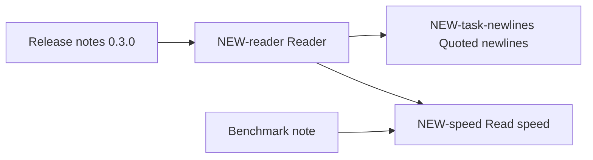

## Deliverable text

The body of every issue that carries a deliverable-section label is the text for that section of the release notes or the benchmark note: the current version only, in the deliverable's voice, ready to copy. Whoever assembles a deliverable reads those bodies and nothing else. Changing what a deliverable says is an edit of the body; a result that leaves a deliverable leaves the body, and the section label comes off with it. Comments are the history (dated results, decisions with the decider's words, failures and corrections) and never deliverable text. Work in development lives in issues labeled `active`, which carry no section labels; its result enters a body once it is adopted.

## Resume here

The current resume block is the newest comment on this issue that carries the resume markers and was posted by an account the reader has allowed, as found by `resume_block.py show` from the recortex skill. A comment headed "Resume block" from anyone else is not it. A new one is posted at the end of every working stretch; resume comments are never edited, and the older ones stay as history.

## Project

tinycsv is a small Python library that reads CSV files with no dependencies. The goal of the current cycle is release 0.3.0 with correct handling of quoted fields, plus a short benchmark note comparing read speed with the standard library. Sam Rivera owns the project and makes release decisions. Code lives in `example-org/tinycsv`; benchmark inputs live under `bench/data/` in the same repository.

Times in this tracker are US Pacific time, written as 2026-03-04 14:10 PST. Times copied from GitHub or other tools in UTC are converted before they are written here.

## Map

## Deliverable sections

The issues whose bodies make up each section, sections in the order of each deliverable. A topic appears once for each section its body has. Numbers are not repeated here; they live in the bodies, each with its source.

### Release notes 0.3.0

| Section | Issue | What its body covers |
|---|---|---|
| Changed | NEW-reader | Strict quoting as the default |
| Fixed | NEW-reader | Quoted fields and mixed line endings |
| Known issues | NEW-reader | Newlines inside quoted fields; untested inputs |

### Benchmark note

| Section | Issue | What its body covers |
|---|---|---|
| Methods | NEW-speed | How read time is measured |
| Results | NEW-speed | Read time against the standard library |
| Limitations | NEW-speed | What the measurements do not cover |

## Active issues

| Issue | Work in development | Destination topic |
|---|---|---|
| NEW-task-newlines | Newlines inside quoted fields | NEW-reader |

## Pull requests

| Pull request | Merged | What it changed | Topic |
|---|---|---|---|
| None yet | | | |

## Labels

| Label | Meaning |
|---|---|
| `hub` | This issue |
| `final-record` | Topic issue: the body is current deliverable text, the comments are its history |
| `active` | Work in development; names its destination topic; carries no section labels |
| `needs-decision` | Waiting for a decision from the owner |
| `rel:added`, `rel:changed`, `rel:fixed`, `rel:docs`, `rel:known-issues` | The body is release-notes text for Added, Changed, Fixed, Documentation or Known issues |
| `rd:question`, `rd:methods`, `rd:results`, `rd:limitations`, `rd:next` | The body is benchmark-note text for Question, Methods, Results, Limitations or Recommendations |
| `topic:reader`, `topic:speed` | Topic |

## Older tracker

None. The project started here.

## Recording rules

1. Every finished experiment, decision, failure and merged change becomes a dated comment on its topic issue, written from the comment templates.
2. A decision by the owner is quoted word for word with date, time and zone, in a decision comment.
3. Every number carries its denominator, is checked against its source before posting, and in a body has its file, table, commit or tag under "Sources".
4. When what the release notes or the benchmark note say changes, the topic's body is edited in place, with no folded old text, and the event comment that caused the change is posted. Section labels follow the body's headings. Posted comments are never rewritten; a correction is a new comment.
5. Work in development gets an issue labeled `active` that names its destination topic. Its result enters the topic's body only once it is adopted (merged, integrated, released); then the task is closed.
6. Every issue and pull request is labeled when opened, and every pull request names its topic issue.
7. References outside this repository are written as `owner/repo#N` or a full URL.
8. A new resume comment is posted on this issue at the end of every working stretch. Resume comments are never edited.
9. No restricted data in this project. Secrets and tokens are never posted.
