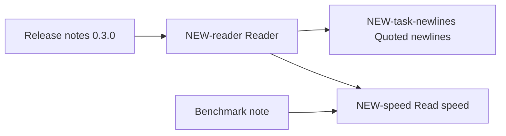

## Resume here

<!-- resume:start -->
**Last updated:** 2026-03-04 16:40 PST by the maintainer's Claude session
**Current focus:** Release 0.3.0. The reader handles quoted fields; newlines inside quoted fields are the last open item.
**Active issues:** NEW-task-newlines (newlines inside quoted fields).
**Last decisions:** 2026-03-04 15:55 PST, strict quoting is the default, see NEW-reader.
**Next actions:**

| Action | Owner | Where |
|---|---|---|
| Finish the state machine for quoted newlines and add the 12 test files | Claude session | NEW-task-newlines |
| Rerun the speed benchmark after the reader change | Claude session | NEW-speed |
| Choose a license before the release | Sam Rivera | this hub |

**Holds:** Do not tag 0.3.0 until Sam Rivera says so.
<!-- resume:end -->

## Project

tinycsv is a small Python library that reads CSV files with no dependencies. The goal of the current cycle is release 0.3.0 with correct handling of quoted fields, plus a short benchmark note comparing read speed with the standard library. Sam Rivera owns the project and makes release decisions. Code lives in `example-org/tinycsv`; benchmark inputs live under `bench/data/` in the same repository.

Times in this tracker are US Pacific time, written as 2026-03-04 14:10 PST. Times copied from GitHub or other tools in UTC are converted before they are written here.

## Map

## Deliverable sections

One table per section of the deliverable. A topic may feed several sections.

### Release notes 0.3.0: fixed

| Topic issue | What it contributes | State |
|---|---|---|
| NEW-reader | Quoted fields and mixed line endings are parsed correctly | in progress |

### Benchmark note: results

| Topic issue | What it contributes | State |
|---|---|---|
| NEW-speed | Read time against the standard library on three files | current for commit 4f2a9c1 |

## Number sources

Every headline number, with the one run it comes from. Numbers from different rows are never combined.

| Number | Value and denominator | Data version | Code version | Configuration | Source path or link | Topic |
|---|---|---|---|---|---|---|
| Conformance files passing | 41 of 53 | conformance set v2 | 4f2a9c1 | strict quoting | `tests/conformance/report-4f2a9c1.txt` | NEW-reader |
| Median read time, 100 MB file | 1.84 s, median of 5 runs | bench data v1 | 4f2a9c1 | Python 3.12, one thread | `bench/out/run-0304/summary.tsv` | NEW-speed |

## Pull requests

| Pull request | Merged | What it changed | Topic |
|---|---|---|---|
| None yet | | | |

## Labels

| Label | Meaning |
|---|---|
| `hub` | This issue |
| `final-record` | Self-contained record of one topic |
| `active` | Bounded task in progress; names its destination topic |
| `needs-decision` | Waiting for a decision from the owner |
| `rel:added`, `rel:changed`, `rel:fixed`, `rel:docs`, `rel:known-issues` | The part of the release notes the issue feeds |
| `rd:question`, `rd:methods`, `rd:results`, `rd:limitations`, `rd:next` | The part of the benchmark note the issue feeds |
| `topic:reader`, `topic:speed` | Topic |

## Older tracker

None. The project started here.

## Recording rules

1. Every finished experiment, decision, failure and merged change becomes a dated comment on its topic issue, written from the comment templates.
2. A decision by the owner is quoted word for word with date, time and zone.
3. Every number carries its denominator and its source path, and is checked against the source before posting.
4. When a conclusion changes, the topic's "Current state" is edited, the replaced text is kept below it in a folded block with its date, and the row here is updated. Posted comments are never rewritten; a correction is a new comment.
5. A bounded task gets an issue labeled `active` that names its destination topic. When it ends, its result is copied into that topic and the task is closed.
6. Every issue and pull request is labeled when opened, and every pull request names its topic issue.
7. References outside this repository are written as `owner/repo#N` or a full URL.
8. The resume block above is updated at the end of every working stretch.
9. No restricted data in this project. Secrets and tokens are never posted.
