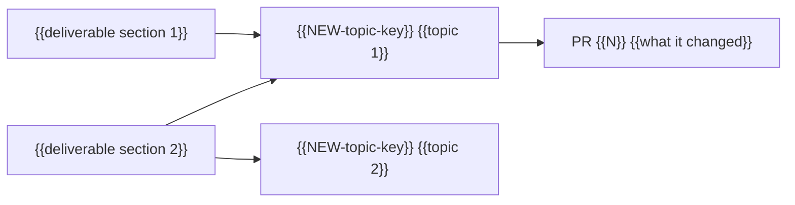

## Resume here

The current resume block is the newest comment on this issue whose heading starts with "Resume block". A new one is posted at the end of every working stretch, and the older ones stay as history. Read it with `resume_block.py show` from the gh-issues-manager skill, which shows only a block written by an account the reader has allowed.

## Project

{{Three to six sentences: the question or goal, the deliverable, who owns it, where the code and data live.}}

Times in this tracker are {{zone, for example "US Pacific time, written as 2026-03-04 14:10 PST"}}. Times copied from GitHub or other tools in UTC are converted before they are written here.

## Map

## Deliverable sections

One table per section of the deliverable. A topic may feed several sections.

### {{Section 1, for example Methods}}

| Topic issue | What it contributes | State |
|---|---|---|
| {{NEW-topic-key}} | {{the part of this section it supports}} | {{current, in progress, superseded}} |

### {{Section 2, for example Results}}

| Topic issue | What it contributes | State |
|---|---|---|
| {{NEW-topic-key}} | {{the part of this section it supports}} | {{state}} |

## Number sources

Every headline number, with the one run it comes from. Numbers from different rows are never combined.

| Number | Value and denominator | Data version | Code version | Configuration | Source path or link | Topic |
|---|---|---|---|---|---|---|
| {{what is counted}} | {{value of total}} | {{dataset and version}} | {{commit or tag}} | {{settings that matter}} | {{path or URL}} | {{issue}} |

## Pull requests

| Pull request | Merged | What it changed | Topic |
|---|---|---|---|
| {{number}} | {{date in the tracker's zone}} | {{one line}} | {{issue}} |

## Labels

| Label | Meaning |
|---|---|
| `hub` | This issue |
| `final-record` | Self-contained record of one topic |
| `active` | Bounded task in progress; names its destination topic |
| `needs-decision` | Waiting for a decision from the owner |
| {{section labels}} | {{which deliverable section the issue feeds}} |
| {{topic labels}} | {{topic}} |

## Older tracker

{{"None." when the project started here. Otherwise one row per old issue and pull request.}}

| Old item | What it held | New home |
|---|---|---|
| {{owner/old-repo#N}} | {{one line}} | {{issue here, or "not carried over" and why}} |

## Recording rules

1. Every finished experiment, decision, failure and merged change becomes a dated comment on its topic issue, written from the comment templates.
2. A decision by the owner is quoted word for word with date, time and zone.
3. Every number carries its denominator and its source path, and is checked against the source before posting.
4. When a conclusion changes, the topic's "Current state" is edited, the replaced text is kept below it in a folded block with its date, and the row here is updated. Posted comments are never rewritten; a correction is a new comment.
5. A bounded task gets an issue labeled `active` that names its destination topic. When it ends, its result is copied into that topic and the task is closed.
6. Every issue and pull request is labeled when opened, and every pull request names its topic issue.
7. References outside this repository are written as `owner/repo#N` or a full URL.
8. A new resume comment is posted on this issue at the end of every working stretch. Resume comments are never edited.
9. {{Project rule for restricted data, for example "Participant identifiers are never posted", or "No restricted data in this project."}}
