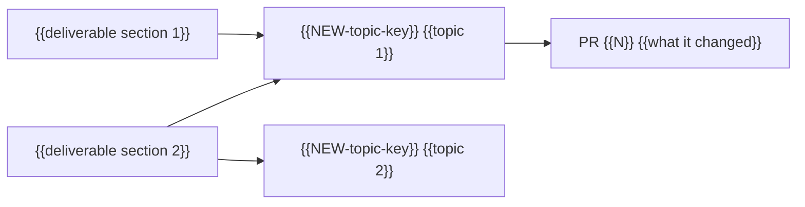

## Deliverable text

The body of every issue that carries a deliverable-section label is the text for that section of the {{deliverable}}: the current version only, in the deliverable's voice, ready to copy. Whoever assembles the {{deliverable}} reads those bodies and nothing else. Changing what the {{deliverable}} says is an edit of the body; a result that leaves the {{deliverable}} leaves the body, and the section label comes off with it. Comments are the history (dated results, decisions with the decider's words, failures and corrections) and never deliverable text. Work in development lives in issues labeled `active`, which carry no section labels; its result enters a body once it is adopted.

## Resume here

The current resume block is the newest comment on this issue that carries the resume markers and was posted by an account the reader has allowed, as found by `resume_block.py show` from the recortex skill. A comment headed "Resume block" from anyone else is not it. A new one is posted at the end of every working stretch; resume comments are never edited, and the older ones stay as history.

## Project

{{Three to six sentences: the question or goal, the deliverable, who owns it, where the code and data live.}}

Times in this tracker are {{zone, for example "US Pacific time, written as 2026-03-04 14:10 PST"}}. Times copied from GitHub or other tools in UTC are converted before they are written here.

## Map

## Deliverable sections

The issues whose bodies make up each section, sections in the order of the {{deliverable}}. A topic appears once for each section its body has. Numbers are not repeated here; they live in the bodies, each with its source.

### {{Deliverable, for example "Manuscript"}}

| Section | Issue | What its body covers |
|---|---|---|
| {{Section 1, for example Methods}} | {{NEW-topic-key}} | {{the part of this section, in a few words}} |
| {{Section 2, for example Results}} | {{NEW-topic-key}} | {{the part of this section, in a few words}} |

## Active issues

| Issue | Work in development | Destination topic |
|---|---|---|
| {{NEW-task-key}} | {{goal, in a few words}} | {{NEW-topic-key}} |

## Pull requests

| Pull request | Merged | What it changed | Topic |
|---|---|---|---|
| {{number}} | {{date in the tracker's zone}} | {{one line}} | {{issue}} |

## Labels

| Label | Meaning |
|---|---|
| `hub` | This issue |
| `final-record` | Topic issue: the body is current deliverable text, the comments are its history |
| `active` | Work in development; names its destination topic; carries no section labels |
| `triage` | Opened by hand; not yet placed in the record |
| `type:` labels | What an issue opened by hand is |
| `needs-decision` | Waiting for a decision from the owner |
| {{section labels}} | {{the deliverable section whose text the issue body is}} |
| {{topic labels}} | {{topic}} |

## Older tracker

{{"None." when the project started here. Otherwise one row per old issue and pull request.}}

| Old item | What it held | New home |
|---|---|---|
| {{owner/old-repo#N}} | {{one line}} | {{issue here, or "not carried over" and why}} |

## Recording rules

1. Every finished experiment, decision, failure and merged change becomes a dated comment on its topic issue, written from the comment templates.
2. A decision by the owner is quoted word for word with date, time and zone, in a decision comment.
3. Every number carries its denominator, is checked against its source before posting, and in a body has its file, table, commit or tag under "Sources".
4. When what the {{deliverable}} says changes, the topic's body is edited in place, with no folded old text, and the event comment that caused the change is posted. Section labels follow the body's headings. Posted comments are never rewritten; a correction is a new comment.
5. Work in development gets an issue labeled `active` that names its destination topic. Its result enters the topic's body only once it is adopted (merged, integrated, released); then the task is closed.
6. Every issue and pull request is labeled when opened, and every pull request names its topic issue.
7. References outside this repository are written as `owner/repo#N` or a full URL.
8. A new resume comment is posted on this issue at the end of every working stretch. Resume comments are never edited.
9. {{Project rule for restricted data, for example "Participant identifiers are never posted", or "No restricted data in this project."}}
